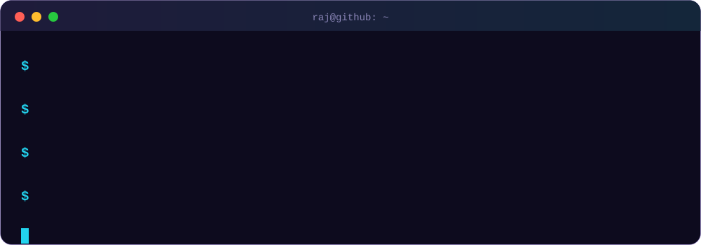

<!--
  RAJ profile README
  Needs the 4 files in an "assets" folder of this same repo:
  header.svg, terminal.svg, skills.svg, divider.svg
  Edit only: YOUR_LINKEDIN and YOUR_EMAIL near the bottom (and any text you like).
-->

  

 

  

 

  
  
  

 

### ⚡ Skills

### 🧭 Quick Facts

<table>
<tr>
  <td width="50%" valign="top">

**🌱 Learning**
- Python & problem solving
- Machine Learning basics
- Building small, useful projects

  </td>
  <td width="50%" valign="top">

**🎯 Goals**
- Ship my first real project
- Contribute to open source
- Grow as a developer every week

  </td>
</tr>
<tr>
  <td valign="top">

**💬 Ask me about**
- Python
- Getting started with GitHub
- Learning to code

  </td>
  <td valign="top">

**🤝 Open to**
- Collaboration
- Internships and learning opportunities
- New ideas

  </td>
</tr>
</table>

<b>💡 How I like to work</b> (click to open)

 

- I learn best by **building**, not just watching tutorials.
- Small commits, often.
- Break big problems into small steps, then solve them one by one.

### 📈 GitHub Stats

  
  
   
  
   
  

### 📫 Connect

  
  
  

    
  ⭐ Thanks for stopping by. Have a great day!

